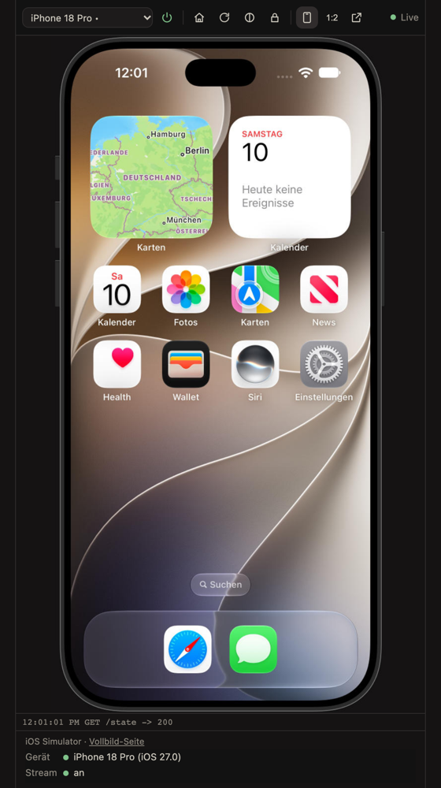
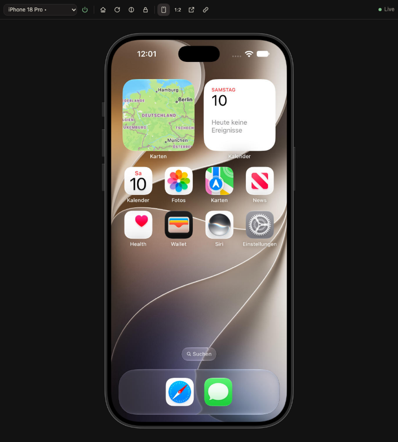
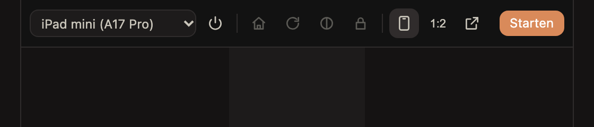
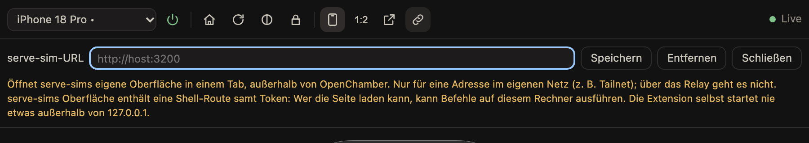

# iOS Simulator for OpenChamber

An [OpenChamber](https://openchamber.dev) extension that shows the iOS Simulator of the machine OpenChamber runs on, live, in Xcode's own device frame, and lets you use it: click to tap, drag to swipe, scroll, type, paste, and press the hardware buttons on the frame.

- **Panel + page**: a rail panel with a toolbar docked above the picture, and a larger full-screen page (OpenChamber > *Extension pages*). A Work Status section says which device runs and whether the stream is on.
- **Works everywhere OpenChamber does**: the picture travels through OpenChamber's shared surface, so the desktop app, a browser and the relay to a phone all see it, with no extra port.
- **Local only**: serve-sim is only ever bound to `127.0.0.1`. No accounts, no telemetry.



| Full-screen page | A device that is off | serve-sim address (page) |
|---|---|---|
|  |  |  |

The screenshots come from the preview harness (`bun run preview`), which draws the surface and loads the frames the way OpenChamber does.

## Features

- **Devices**: every available iPhone and iPad. Picking a running device switches the picture at once. Picking one that is off shows it as off with a **Boot** button: nothing boots until you click it. Several simulators may run at once; the power button shuts down only the device shown.
- **Toolbar**: Home, Rotate, Light/Dark, Lock, device frame on/off, picture size (**1:1**, **1:2**, **1:3**), and **Open in serve-sim**.
- **Picture size**: full, half (default) or a third per side. Smaller is smoother, above all over the network. Frame, page and input follow the size.
- **Device frame**: Xcode's own frame for the device, read from the Xcode installed on the machine; nothing is shipped. Its buttons can be clicked (volume, action, side button).
- **Keyboard**: typed and pasted text arrives as written, through the simulator's own hardware keyboard layout (German and US built in).
- **Open in serve-sim**: opens serve-sim's own interface, at an address you store on the page, in a tab of its own (see [Security boundary](#security-boundary)).

## Speed

Measured with `node scripts/bench.mjs` on the machine running the simulator (18-core macOS VM, iPhone 18 Pro, the device turning back and forth so the screen keeps changing). serve-sim delivers about 29 frames a second in this test. "Delivered" is what a viewer pulling one frame at a time, like OpenChamber's surface, actually receives.

| Mode | Before | After |
|---|---|---|
| Framed, half size (default) | n/a | **27.8 fps, 41 KB per frame** |
| Framed, full size | 13.0 fps, 223 KB | 22.6 fps, 223 KB |
| Plain, full size | 24.0 fps, 154 KB | 28.7 fps, 153 KB |
| Plain, half size | n/a | 26.3 fps, 29 KB |
| Framed, a third | n/a | 28.5 fps, 24 KB |

Before: one frame size, two compose workers, jpeg-js. After: shrinking in 2 to 4 workers by core count, MozJPEG for shrunk pictures. Over a network the smaller frames matter most: 1.1 MB/s instead of 2.7 MB/s for the framed picture.

## Prerequisites

- macOS with Xcode and at least one iOS simulator runtime (`xcrun simctl list devices`).
- [serve-sim](https://github.com/EvanBacon/serve-sim) 0.1.47 or newer on the PATH of the OpenChamber server: `npm install -g serve-sim`.
- OpenChamber 2.2.0 or newer, web server or desktop app (VS Code and mobile do not load extensions).
- The extension's **local service** permission (requested once at install).

## Install

1. Open **Settings > Extensions** in OpenChamber.
2. Paste one of these into *Folder, ZIP, or URL* and choose **Add**:

   ```text
   https://github.com/bemany/openchamber-ios-simulator.git
   ```

   or a local checkout for development:

   ```text
   /path/to/openchamber-ios-simulator
   ```

3. Approve the single permission, **Run a local service**, then *Allow and enable*. The service runs these programs:

   | Program | Why |
   |---|---|
   | `xcrun` | `simctl`: list, boot and shut down devices, appearance, keyboard layout, screenshots; `plutil`: the device type's display data for the frame |
   | `serve-sim` | the picture and the touch, key and button input |
   | `sips` | renders Xcode's frame PDFs once per device and size, and rotates full-size landscape pictures without a frame (macOS built-in) |

   As with every OpenChamber service, the list is shown for approval but does not sandbox the process: it runs with your user's access.

4. The rail icon **iOS Simulator** appears on the right-hand rail; the full-screen page appears under **Extension pages** above the session list; the Work Status section shows the device.
5. Optional: on the full-screen page, the link button stores a serve-sim address for **Open in serve-sim**.

## Develop

```bash
bun install
bun run check                       # tsc --noEmit, bun test, build into dist/
node scripts/smoke.mjs              # start the built service like OpenChamber and read a real frame
node scripts/bench.mjs              # frames per second and size per mode (turns the device shown)
bun run preview                     # stand-in host on http://127.0.0.1:4790/<random>/, page at <random>/page
```

`dist/` is committed because OpenChamber serves built files and never builds an extension, so a Git or folder install runs without a build step. Rebuild after editing TypeScript, then disable and enable the extension to restart its service. More detail is in [AGENTS.md](AGENTS.md).

## Architecture

```text
┌──────────────────────────── OpenChamber ─────────────────────────────┐
│  surface (host canvas)    panel/ (toolbar)   page/ (canvas + frame)  │
│     │ frames / input          │ serviceRequest      │ serviceRequest │
│     ▼                         ▼                     ▼                │
│  service/main.ts (bundled Node service, host runtime)                │
│    · binds 127.0.0.1:${OPENCHAMBER_SERVICE_PORT} only                │
│    · requires Authorization: Bearer ${OPENCHAMBER_SERVICE_TOKEN}     │
│    · simulator.ts   devices, stream, HID socket, boot/shutdown       │
│    · present.ts     newest frame wins; 2 to 4 compose workers        │
│    · compose-worker decode (MozJPEG) > shrink > frame > turn > encode│
│    · chrome.ts      Xcode's frame from the local Xcode, cached       │
│    · input.ts       pointer/wheel/keys > serve-sim HID messages      │
│           │  MJPEG + HID WebSocket                                   │
│           ▼                                                          │
│  serve-sim helper on 127.0.0.1 (reused, or started for the device)   │
│           │                                                          │
│  iOS Simulator                                                       │
└──────────────────────────────────────────────────────────────────────┘
```

- **Picture**: the service reads serve-sim's MJPEG stream and hands the newest frame to OpenChamber's surface (`GET /surface/frame`) while a viewer is open. Workers shrink it to the chosen size, put it into the device frame (the screen goes through the frame's rounded-corner mask) and turn the whole device for landscape.
- **Device frame**: the device type's `capabilities.plist` gives the screen size, scale, frame id and mask; `/Library/Developer/DeviceKit/Chrome/<id>.devicechrome` gives `chrome.json` and the PDFs (a composite body or nine slices, plus buttons). PDFs are rendered with `sips` once per size and cached in `$TMPDIR`; buttons are placed the way serve-sim places them. JPEG has no alpha, so the panel sends its background colour (`POST /frame-style`).
- **Full-screen page**: extensions cannot open windows, so the larger view is an extension page (`contributes.page`). It draws shrunk raw frames in a canvas, lays the frame over them as an image with a CSS mask, turns the device with CSS and maps input back to picture pixels (`POST /page/input`). OpenChamber cuts a `serviceRequest` answer at 256 000 characters, so frames and frame images travel as references whose base64 the page fetches in parts (`GET /blob`).
- **Input**: pointer, wheel and keys become serve-sim HID messages (touch begin/move/end, scroll, key usages) normalized to the screen. A click on a frame button presses it; a click on the rest of the bezel does nothing. Characters go through a table for the simulator's hardware keyboard layout, read from its `AppleKeyboards` setting.

### Service routes

All behind the host's token, on `127.0.0.1`:

| Route | |
|---|---|
| `GET /surface/frame`, `POST /surface/input`, `POST /surface/control`, `POST /surface/resize`, `GET /surface/clipboard` | OpenChamber shared surface |
| `GET /state`, `GET /stats` | devices, device shown, stream, orientation, appearance, keyboard, frame, picture size; frame counters for the bench |
| `POST /select` `{ udid }`, `POST /boot` `{ udid }`, `POST /shutdown` | show a device; boot it (only on request); shut down the device shown |
| `POST /button` `{ name, page?, usage? }`, `POST /rotate`, `POST /appearance` | toolbar actions and frame buttons |
| `POST /frame` `{ on }`, `POST /frame-style` `{ background }`, `POST /quality` `{ value }` | device frame, colour behind it, picture size (`full`, `balanced`, `fast`) |
| `GET /page/frame`, `POST /page/input`, `GET /chrome`, `GET /blob?id=&offset=` | full-screen page |
| `POST /tap` `{ x, y }` (0..1), `GET /screenshot`, `GET /ax` | tap, PNG screenshot (base64), accessibility tree |

## Security boundary

- The service listens on `127.0.0.1` only and answers nothing without OpenChamber's bearer token. The panel and page never see that token; they reach the service only through `host.serviceRequest()`.
- serve-sim is only ever bound to `127.0.0.1`. The service reuses a serve-sim server already listening on loopback, or starts `serve-sim <udid> --port 31xx --host 127.0.0.1 --exit-on-simulator-shutdown`. It never starts, reuses or touches a serve-sim preview server on another interface: that server's page carries a token for a shell route, so anyone who can load the page can run commands on the machine.
- **Open in serve-sim** is opt-in. It only opens an address you stored yourself (kept in OpenChamber's instance storage for this extension, never in the repository) through `host.openUrl`, in a tab outside OpenChamber. Use it only for an address in your own network, such as your tailnet; it does not work over the relay. Embedding serve-sim inside the page is not possible: OpenChamber's page policy allows frames, images and connections only from the extension's own files (and approved https origins), which keeps third-party pages from reaching your network.
- The device frame is rendered from the Xcode on the machine at runtime; no Apple artwork is in this repository.

## Troubleshooting

| What you see | Meaning | Fix |
|---|---|---|
| *Service not approved yet* | OpenChamber has not approved the local service | Settings > Extensions: approve **Run a local service** |
| *No iOS simulators installed* | `xcrun simctl` lists no iPhone or iPad | Install an iOS runtime in Xcode (Settings > Components) |
| *<device> is off* with **Boot** | The chosen device is not running | Click **Boot**, or pick a running device |
| *No stream*, or an error about serve-sim | No serve-sim helper on loopback could be started | `npm install -g serve-sim`; check `$TMPDIR/openchamber-ios-simulator-serve-sim.log` |
| Taps do nothing | serve-sim's input is shadowed by Device Hub | `serve-sim repair-input` (restarts SpringBoard), then reopen the panel |
| Picture stutters over the network | Large frames | Use **1:2** or **1:3**, or hide the device frame |
| **Open in serve-sim** only shows a hint | No address stored yet | Full-screen page > link button > enter the address > **Save** |
| Typed characters come out wrong | The simulator's hardware keyboard layout is neither German nor US | Typed as US for now (see the issues) |

## Limitations

- Copying out of the simulator is not offered, and pasting types the text key by key, so characters without a key in the layout (emoji, some accents) are skipped.
- Agents cannot call the extension yet: `contributes.tools` in OpenChamber 2.2 only changes how tool calls look.
- iPhone apps that do not support landscape (Home Screen, Settings) appear sideways after Rotate, as in Simulator.app.

## Deutsch

OpenChamber-Extension, die den iOS-Simulator der Maschine, auf der OpenChamber läuft, live im echten Xcode-Geräterahmen zeigt und bedienbar macht: Tippen, Wischen, Scrollen, Tastatur, Einfügen und die Tasten am Rahmen. Rail-Panel mit Leiste, Vollbild-Seite (Extension pages) und Statusabschnitt. Bildgröße 1:1, 1:2 (Standard) oder 1:3; halbe Größe mit Rahmen läuft mit knapp 28 Bildern pro Sekunde bei 41 KB pro Bild. Ein laufendes Gerät zu wählen schaltet sofort um; ein ausgeschaltetes bootet erst nach Klick auf **Starten**. **In serve-sim öffnen** öffnet eine selbst eingetragene serve-sim-Adresse in einem eigenen Tab (nur im eigenen Netz, nicht über das Relay; serve-sims Seite enthält eine Shell-Route). Die Extension selbst bindet serve-sim nur an `127.0.0.1`. Die Oberfläche ist auf Deutsch, wenn OpenChamber auf Deutsch läuft.

## License

MIT. The built service includes jpeg-js (BSD-3-Clause), @jsquash/jpeg (Apache-2.0) and MozJPEG/libjpeg-turbo (IJG, BSD-3-Clause, zlib); see [THIRD_PARTY_NOTICES.md](THIRD_PARTY_NOTICES.md). This software is based in part on the work of the Independent JPEG Group.
