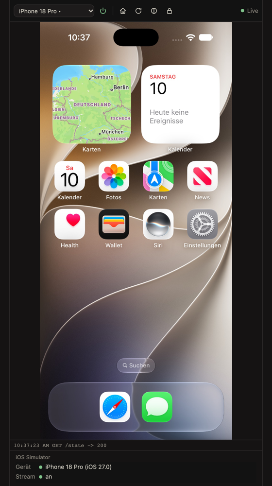
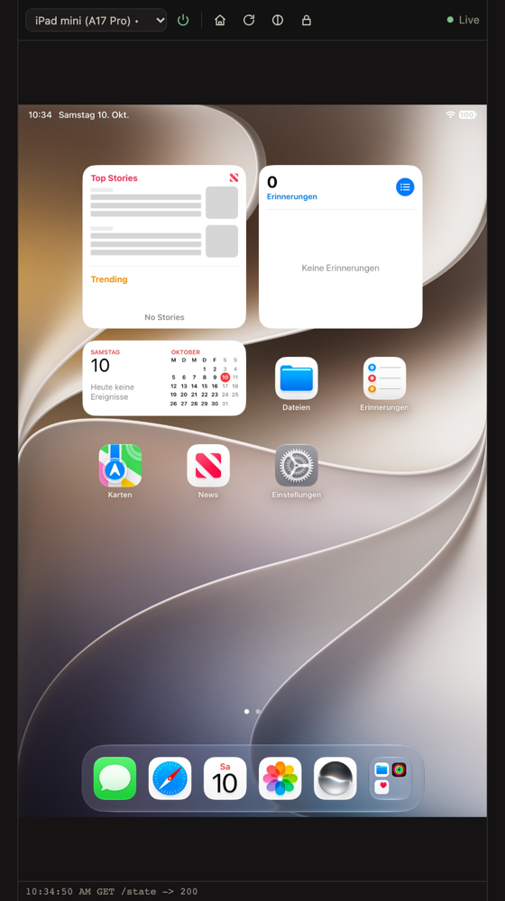
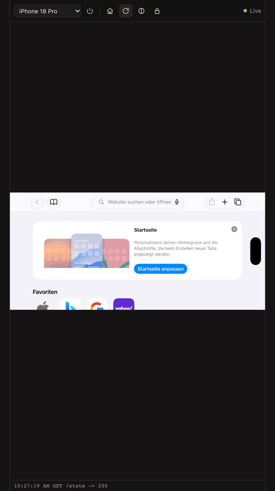
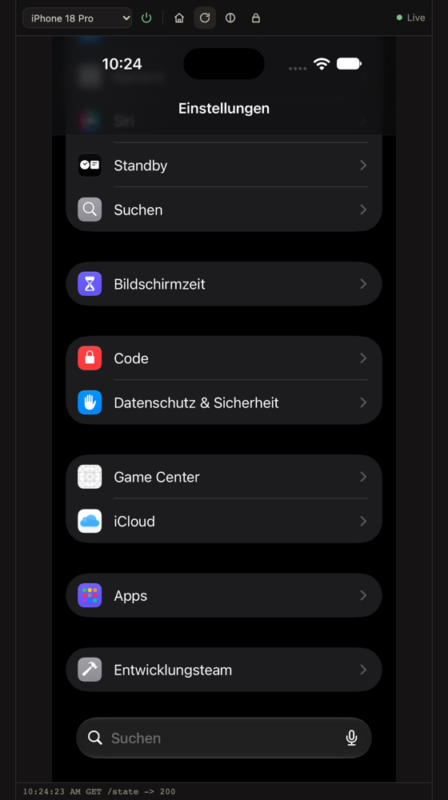

# iOS Simulator for OpenChamber

An [OpenChamber](https://openchamber.dev) extension that shows the iOS Simulator of the machine OpenChamber runs on as a live panel, and lets you use it: click to tap, drag to swipe, scroll, type, paste. The picture sits in Xcode's own device frame (switchable), and the hardware buttons on the frame can be clicked. A docked toolbar picks the device, boots and shuts it down, and has Home, Rotate, Light/Dark, Lock and frame on/off. A full-screen page (Extension pages menu) shows the same device larger, and a Work Status section says which device runs and whether the stream is on.

It is built on [serve-sim](https://github.com/EvanBacon/serve-sim) and OpenChamber's shared surface, so the picture reaches every client OpenChamber serves (desktop app, browser, and the relay to a phone) without opening any extra port.



| iPad | Rotated | Dark |
|---|---|---|
|  |  |  |

The screenshots come from the preview harness (`bun run preview`), which draws the surface the way OpenChamber does. They predate the device frame.

## Requirements

- macOS with Xcode and at least one iOS simulator runtime (`xcrun simctl list devices`).
- serve-sim 0.1.47 or newer on the PATH of the OpenChamber server: `npm install -g serve-sim`.
- OpenChamber 2.2.0 or newer (web server or desktop app; VS Code and mobile do not load extensions).

## Install

Settings > Extensions, then add this repository's Git URL (or a local clone's folder). The extension asks for one capability, a local **service** that runs these programs:

| Program | Why |
|---|---|
| `xcrun` | `simctl`: list, boot and shut down devices, appearance, keyboard layout, screenshots; `plutil`: reads the device type's display data for the frame |
| `serve-sim` | the stream and the touch, key and button input |
| `sips` | renders Xcode's frame PDFs once per device, and rotates the picture in landscape when the frame is off (macOS built-in) |

As with every OpenChamber service, the list is shown for approval but does not sandbox the process; it runs with your user's access.

## How it works

```
OpenChamber surface (any client)  --frames/input-->  OpenChamber server
                                                        |  loopback, token
                                                        v
                                            extension service (127.0.0.1)
                                              |  MJPEG + HID WebSocket
                                              v
                                serve-sim helper on 127.0.0.1 only
                                              |
                                        iOS Simulator
```

- **Picture.** The service reads serve-sim's MJPEG stream from a helper bound to `127.0.0.1` and hands the newest frame to OpenChamber's surface (`GET /surface/frame`). Frames are pulled only while a viewer is open.
- **Device frame.** Nothing is shipped: the frame comes from the Xcode installed on the machine. The device type's `capabilities.plist` gives the screen size, scale, chrome id and the rounded-corner mask; `/Library/Developer/DeviceKit/Chrome/<id>.devicechrome` gives `chrome.json` and the PDFs (a composite body or nine slices, plus the buttons). The PDFs are rendered once with `sips` and cached in `$TMPDIR`; buttons are placed the way serve-sim places them. Two worker threads put each frame into the device (MozJPEG WebAssembly decode, jpeg-js encode), about 70 ms per iPhone frame, newest frame wins. Rotation turns the whole device. With the frame off, landscape frames are rotated with `sips` instead (about 30 ms). JPEG has no alpha, so the panel sends its background colour (`POST /frame-style`) and the frame is laid on it.
- **Full-screen page.** Extensions cannot open windows, so the larger view is an extension page (`contributes.page`). It draws raw frames itself in a canvas, lays the frame over them as an image with a CSS mask, turns the device with CSS and maps input back to framebuffer pixels (`POST /page/input`). OpenChamber cuts a `serviceRequest` answer at 256 000 characters, so frames and frame images travel as references (`GET /page/frame`, `GET /chrome`) whose base64 the page fetches in parts from `GET /blob`.
- **Helper.** The service reuses any serve-sim server already listening on loopback, or starts `serve-sim <udid> --port 31xx --host 127.0.0.1 --exit-on-simulator-shutdown` itself. It never binds anything to another interface, and it never touches a serve-sim preview server someone started on a LAN or Tailscale address (that server has a token-gated shell route).
- **Input.** Pointer, wheel and keys from the surface become serve-sim HID messages (touch begin/move/end, scroll, key usages), normalized to the portrait framebuffer. On a framed picture a click on the screen counts on the screen, a click on a hardware button presses it, and a click on the rest of the bezel does nothing. Characters are typed through a table for the simulator's hardware keyboard layout, read from its `AppleKeyboards` setting, so `@` arrives as `@` whatever your own keyboard layout is. German and US layouts are built in; other layouts are typed as US.
- **Devices.** The picker lists every available iPhone and iPad. Picking a running device switches the picture to it at once; picking one that is off boots it. Other running simulators keep running, and the power button shuts down only the device shown. The last choice and the frame setting are remembered per OpenChamber instance.

### Service routes

All behind the host's token, on `127.0.0.1`:

| Route | |
|---|---|
| `GET /surface/frame`, `POST /surface/input`, `POST /surface/control`, `POST /surface/resize`, `GET /surface/clipboard` | OpenChamber shared surface |
| `GET /state` | devices, active device, stream, orientation, appearance, keyboard layout |
| `POST /boot` `{ udid }`, `POST /shutdown`, `POST /select` `{ udid }` | device lifecycle |
| `POST /button` `{ name, page?, usage? }`, `POST /rotate`, `POST /appearance` | toolbar actions and frame buttons |
| `POST /frame` `{ on }`, `POST /frame-style` `{ background }` | device frame on/off, background colour behind it |
| `GET /page/frame`, `POST /page/input`, `GET /chrome`, `GET /blob?id=&offset=` | full-screen page: raw frames, input in framebuffer pixels, the frame as images, parts of large answers |
| `POST /tap` `{ x, y }` (0..1), `GET /screenshot`, `GET /ax` | tap, PNG screenshot (base64), accessibility tree |

## Limitations

- Copying from the simulator to your clipboard is not offered (`simctl pbpaste` is unreliable on recent Xcode), and pasting types the text key by key, so characters the keyboard layout has no key for (emoji, some accents) are skipped.
- Agents cannot call the extension yet: `contributes.tools` in OpenChamber 2.2 only changes how tool calls look. Agents keep using serve-sim or `xcrun simctl` directly.
- iPhone apps that do not support landscape (the Home Screen, Settings) appear sideways after Rotate, as they do in Simulator.app.
- Framing costs CPU (about 70 ms per frame in a worker). Turn the frame off on slow machines.
- Running several simulators at once needs memory; the extension does not stop you.

## Develop

```sh
bun install
bun run check        # typecheck, unit tests, build into dist/
node scripts/smoke.mjs                 # start the built service like OpenChamber does and read a real frame
SMOKE_TAP=0.5,0.5 node scripts/smoke.mjs
bun run preview                        # stand-in host on http://127.0.0.1:4790/<random>/
```

`dist/` is committed because OpenChamber serves built files and never compiles an extension. `bun run preview` also serves the full-screen page at `<prefix>/page`, and its stand-in host cuts answers at 256 000 characters like the real one.

## Deutsch

OpenChamber-Extension, die den iOS-Simulator der Maschine, auf der OpenChamber läuft, live im Panel zeigt und bedienbar macht (Tippen, Wischen, Scrollen, Tastatur, Einfügen). Das Bild steckt im echten Xcode-Geräterahmen (abschaltbar), die Tasten am Rahmen lassen sich anklicken. Die angedockte Leiste wählt das Gerät, startet und beendet es und hat Home, Drehen, Hell/Dunkel, Sperren und Rahmen an/aus. Eine Vollbild-Seite (Menü Extension pages) zeigt das Gerät größer. Mehrere Simulatoren dürfen gleichzeitig laufen; ein laufendes Gerät zu wählen schaltet sofort um. Der Statusabschnitt zeigt das laufende Gerät und ob der Stream an ist. Die Oberfläche ist auf Deutsch, wenn OpenChamber auf Deutsch läuft. Der Stream läuft über OpenChambers Surface-Mechanismus und funktioniert damit auch über das Relay; serve-sim wird nur an `127.0.0.1` gebunden.

## License

MIT. The built service includes jpeg-js (BSD-3-Clause), @jsquash/jpeg (Apache-2.0) and MozJPEG/libjpeg-turbo (IJG, BSD-3-Clause, zlib); see [THIRD_PARTY_NOTICES.md](THIRD_PARTY_NOTICES.md). This software is based in part on the work of the Independent JPEG Group.
